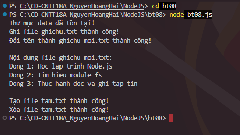
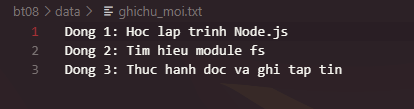

BÀI TẬP 08 - NODEJS MODULE FS

1. Giới thiệu

Bài tập thực hành sử dụng module fs trong Node.js để thao tác với thư mục và tập tin.

2. Nội dung thực hiện

Tạo thư mục data.

Tạo tập tin ghichu.txt.

Ghi ít nhất 3 dòng nội dung vào tập tin.

Đổi tên ghichu.txt thành ghichu_moi.txt bằng fs.rename().

Đọc và hiển thị nội dung tập tin sau khi đổi tên.

Tạo tập tin tam.txt.

Xóa tập tin tam.txt bằng fs.unlink().

Hiển thị thông báo sau mỗi thao tác.

3. Các lệnh thực hiện

Tạo và chạy chương trình

bash

node bai08.js

Các hàm fs sử dụng

fs.mkdirSync(): Tạo thư mục.

fs.writeFileSync(): Tạo và ghi tập tin.

fs.renameSync(): Đổi tên tập tin.

fs.readFileSync(): Đọc nội dung tập tin.

fs.unlinkSync(): Xóa tập tin.

4. Hình ảnh minh chứng

Ảnh 1: Chạy chương trình

Ảnh 3: Kết quả cuối cùng

